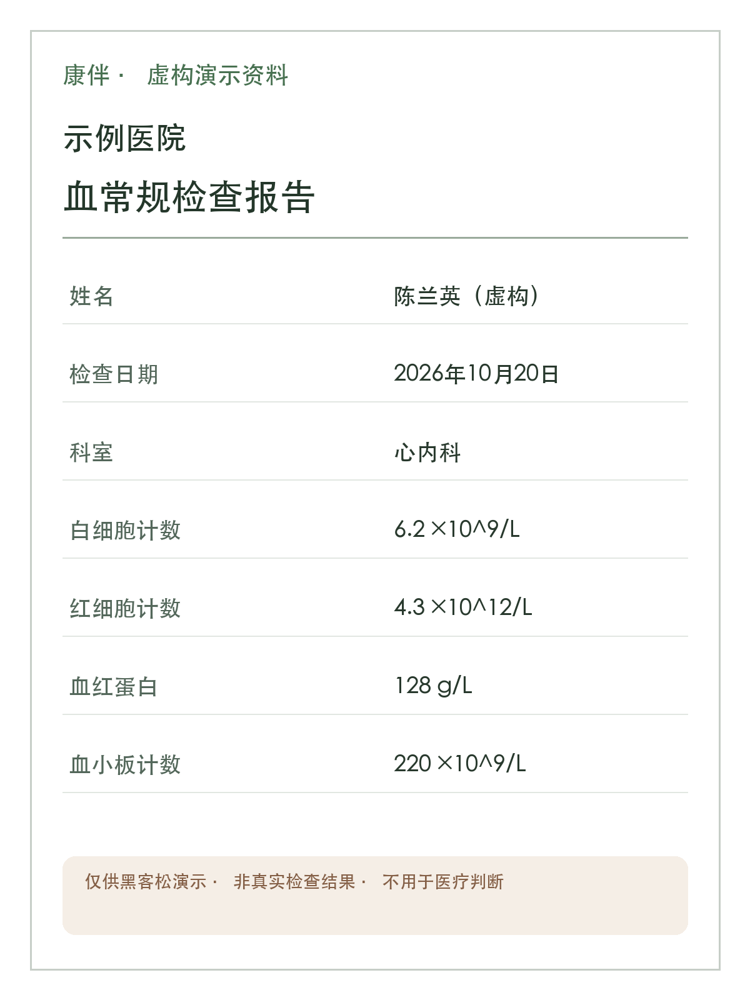

# 01 · 康伴 · 全家健康管理

> 一家人分住两三个地方，老人的血压、血糖、吃什么药、上次检查什么时候做的，散在各自的记忆和手机相册里。

**一句话：** 把一家人的健康信息收进同一套档案——报告拆成指标、资料聚成可复用的卷、设备异常和服药到点会主动提醒、要看医生时扫码授权——让不在身边的子女也管得动父母的健康。

**它管的不是「一次看病」，是一个家庭长期的健康信息。** 看病、陪诊、报销都只是它被用到的几个时刻。

---

## 问题长什么样

一次陪诊结束，你手里会多出：一张血常规、一张缴费单、一张处方、两段医生口头说的话、一个下次复诊的日期。它们分别去了相册、口袋、微信收藏、和你的脑子。

三个星期后要给老人报销——你缺什么，事前不知道；跑几趟才知道。

半年后换医院复诊，医生问「之前用过什么药、上次这个指标多少」，你翻不出。老人自己更翻不出。

行业里做健康产品的，大多只做其中一段：要么记步数、要么管挂号、要么做陪诊平台。**很少有人把「一家人的健康信息」当成一件事来管**——所以每换一个环节，资料就断一次。

## 两个核心设计（底座）

其余功能都长在这两条上面。它们不新，但很少有人两条都做到底。

### 一 · 把体检报告变成指标，健康信息才同步得动

一张报告拍进去，不是存成一张图躺在相册里。是当场拆成一条条指标：项目名、数值、单位、参考范围、是否异常、检查日期。

拆开之后才有后面这些：同一个指标跨年份的趋势、这次比上次高了多少、哪些指标连着两次异常该随访、复诊时该翻出哪几张单子。

子女在异地打开手机，看到的不是「我爸做了个检查」，是「低密度脂蛋白连续两次偏高」。**存图是记录，存指标才是同步。**

### 二 · 把资料聚成档案，才谈得上复用

散着的照片是一次性的，这张用完就沉底了。

所以同一份东西同时挂在三个维度上：按人（这个人所有资料在一处）／按病（同一病种从首诊到复诊是一条时间线）／按险种（这次报销要的那几份归一组）。

建一次档，往后每次就诊都是往里加，不是重新翻相册。复用体现在三个动作上：报销时按险种自动凑材料、复诊时按病种调出历史、换医院时整份档案能带走。

## 底座上面，长出来四件事

### 一 · 到点该吃药了

处方识别入库后自动生成服药计划：什么药、一次几片、一天几次、饭前还是饭后、吃到哪天。到点提醒本人；漏服隔一段时间再提醒一次；连续漏服，提醒推给子女。

药快吃完提前提醒补药——比「记住吃药」更实际的问题是「药没了没人知道」。

### 二 · 家里那台设备响了

血糖、血压、跌倒这三类事件走同一个入口，按严重程度分三级处理：

- **红**：跌倒、血糖危急值、血压超阈值 → 电话外呼 + 强提醒，直接打到子女手机上
- **黄**：单次血糖偏高、血压偏高 → 推送提醒，不当场打扰
- **蓝**：日常测量数据 → 汇进每日小结，不弹窗

原则是**按级别决定打扰谁**，不是所有异常都弹窗——全弹的结果是全家把通知关掉，等于没做。

> 当前版本用模拟设备事件跑通了整条链路（事件 → 分级 → 通知 → 进档案）。真实硬件接入（蓝牙血压计、血糖仪、健康平台 API）在路线图里，接口位置已留。

### 三 · 明天要陪诊，谁去跑

家属在应用里发布陪诊需求：时间、医院、科室、要办的事、要不要代取报告。陪诊师接单，按八步清单干活，每一步要传现场佐证才推进得了。

**四个角色，付钱的和用的不是同一个人。** 子女（付钱、做决定、半夜接电话）／老人（只按一个按钮）／陪诊师（现场跑腿、拍照上传）／平台（审核资质、留痕）。

**八步履约清单是可勾选的，不是宣传语。** 电话确认 → 取号挂号 → 候诊陪同 → 代述病情 → 检查缴费取药 → 领取报告 → 复诊预约 → 服务小结。必传佐证的步骤没传现场照片，就完不成这一单——**流程不靠自觉，靠状态机**。

### 四 · 医生要看历史，扫一下码

家属生成一个 6 位分享码（或二维码），10 分钟有效、可撤销、每次访问留痕。医生或陪诊师扫码后看到的是一份只读摘要：这个人的指标趋势、异常项、在吃的药、相关报告清单。

**看到的范围是家属勾的，不是全部。** 只读、不能下载原始附件、过期即失效、谁在什么时候看过有记录。

陪诊师端根本没有「健康档案」入口——要拿信息只有这一条路。隐私是结构性的，不是承诺。

**顺带解决的，是报销。** 按险种点一下，算出缺哪几份、打包成能提交的材料。这是上面档案能力的一个出口，不是主线。

## 我的角色

团队项目。我负责产品设计、业务链梳理与 AI 实现；需求、设计、架构三份文档是我带着问题一条条问出来、再落成文的。

面试式提问的例子：*「老人自己会不会操作？」* → 不会 → 那老人端只能有一个按钮 → 那档案归属必须挂在子女账号下 → 那分享机制必须是一次性的。一个问题改三层设计。

第二个例子：*「异常了通知谁？」* → 得通知子女，但不能吓到老人 → 那就先分级，再决定谁被打扰 → 分级标准要能解释给家属听，不能是黑箱。

## 技术

- 静态 PWA（HTML + 原生 JS + CSS），零构建，手机加主屏即用
- Supabase：Auth 登录、家庭工作区、社区订单工作流、私有附件 Storage，**9 个 SQL 迁移，全表 RLS**
- 浏览器本地 OCR（Tesseract.js），PDF 作附件留存、字段手填
- **指标模型**：一份化验单拆成「项目 / 数值 / 单位 / 参考范围 / 异常标记 / 检查日期」，17 项已跑通；新指标连参考范围一起登记即可，不加表、不改代码
- **体检看板**：多指标趋势、异常随访跟踪。数据全部来自上面那张指标表，不是截图比对
- **事件入口统一**：设备事件、服药漏服、指标异常归成同一种结构，走同一套分级规则，加一类事件不改通知逻辑
- **分享令牌**：一次性、带过期时间、带访问日志、只读视图，前端不留缓存

## 看一眼

这两张是系统里的**演示资料**，人物、医院、药品名全为虚构，用于跑通「拍照 → 本地识别 → 逐项核对 → 拆成指标入库 → 出趋势、自动生成服药计划」这条线。

| 化验报告 | 处方医嘱 |
|---|---|
|  |  |

识别出来不是直接入库：先给你看原文与字段对照，你逐项核对，确认才写进去。手写体、模糊图认不准的时候，系统不填、也不开用药提醒。

## 现状

- 云端链路已通：真实账号 + RLS 的订单流，可演示
- 家庭端五 Tab：首页 / 健康档案 / 医疗资料 / 陪诊 / 我的——**「健康档案」是指标与趋势，「医疗资料」是可复用档案库，「陪诊」是需求发布与履约**
- 服药计划、分级预警、一次性分享码三条链路已跑通（硬件事件用模拟数据）
- 内置四位家庭成员**虚构样例**账号，病例与演示订单均为虚构
- 未接入真实医院、真实支付、真实硬件设备——这是原型，边界写在 README 第一段

## 什么没做（主动说）

- **后台定时推送**：浏览器关闭或离线时，当前版本保证不了准时。真要做，得加服务端推送
- **真实硬件接入**：现在只有模拟事件，蓝牙设备与健康平台 API 未接
- **医生手写中文识别**：不保证准确，必须人工核对
- **陪诊师资质审核**：目前靠管理员在 Supabase 后台人工过
- **用药相互作用检查**：只做提醒，不做药理判断，不越界

---

*仓库私有。需要看代码可以单独开权限，或现场演示。*
