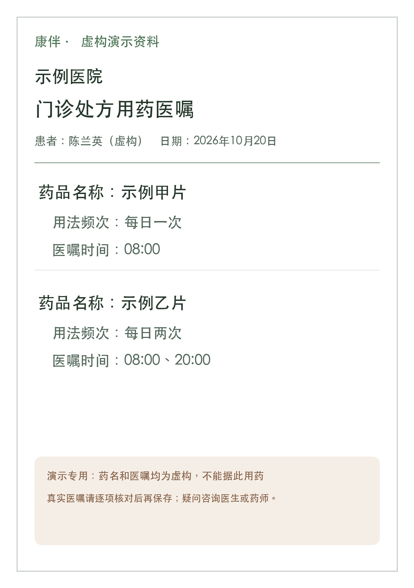

# 01 · 康伴 · 家庭就医助手

> 家人带老人看病，体检报告、出院小结、发票散在手机相册和抽屉里；报销时缺什么不知道，来回跑几趟。

**一句话：** 把体检报告拆成指标，把散着的医疗资料聚成一份能反复用的档案；在这两件事之上，才算得出报销缺哪几份、复诊该带什么。

---

## 问题长什么样

一次陪诊结束，你手里会多出：一张血常规、一张缴费单、一张处方、两段医生口头说的话、一个下次复诊的日期。
它们分别去了相册、口袋、微信收藏、和你的脑子。

三个星期后要给老人报销——你缺什么，事前不知道；跑几趟才知道。

行业里做健康产品的，大多在做「记录」。真实卡住家庭的是**跑腿和报销**。

但报销不是第一步。第一步是**资料有没有被整理成能用的东西**——所以整件事收在两个设计上。

## 两个核心设计

其余所有功能都是围着这两条转的。它们不新，但很少有人两条都做到底。

### 一 · 把体检报告变成指标，健康信息才同步得动

一张报告拍进去，不是存成一张图、躺在相册里。是当场拆成一条条指标：项目名、数值、单位、参考范围、是否异常、检查日期。

拆开之后才有后面这些：同一个指标跨年份的趋势线、这次比上次高了多少、哪些指标连着两次异常该随访、复诊时该从历史里翻出哪几张单子。

子女在异地打开手机，看到的不是「我爸做了个检查」，是「低密度脂蛋白连续两次偏高」。**存图是记录，存指标才是同步。**

### 二 · 把资料聚成档案，才谈得上复用

散着的照片是一次性的，这张用完就沉底了。

所以同一份东西要同时挂在三个维度上：按人（这个人的所有资料在一处）／按病（同一病种从首诊到复诊是一条时间线）／按险种（这次报销要的那几份归一组）。

建一次档，往后每次就诊都是往里加，不是重新翻相册。复用体现在三个动作上：报销时按险种自动凑材料、复诊时按病种调出历史、换医院时整份档案能带走。

## 做法

**四个角色，付钱的和用的不是同一个人。**
子女（付钱、做决定、半夜接电话）／老人（只按一个按钮）／陪诊师（现场跑腿、拍照上传）／平台（审核资质、留痕）。

**八步履约清单，是可勾选的，不是宣传语。**
电话确认 → 取号挂号 → 候诊陪同 → 代述病情 → 检查缴费取药 → 领取报告 → 复诊预约 → 服务小结。
必传佐证的步骤没传现场照片，就完不成这一单——**流程不靠自觉，靠状态机**。

**隐私是结构性的，不是承诺。**
陪诊师端根本没有"健康档案"入口。要拿信息只有一个办法：家属生成 6 位分享码，10 分钟有效、可撤销、访问留痕。他能看到的只有这一次任务。

**OCR 在浏览器里跑。**
Tesseract.js 本地识别，报告照片不上传第三方。识别置信度低就不自动填、不开用药提醒。
医生手写体认不准——这件事写在 README 里，不藏。

**健康预警分三级。**
红（电话外呼 + 强提醒）／黄（推送）／蓝（进每日汇总）。按级别决定打扰谁，不是全都弹窗。

## 我的角色

团队项目。我负责产品设计、业务链梳理与 AI 实现；需求、设计、架构三份文档是我带着问题一条条问出来、再落成文的。

面试式提问的例子：*「老人自己会不会操作？」* → 不会 → 那老人端只能有一个按钮 → 那档案归属必须挂在子女账号下 → 那分享机制必须是一次性的。
一个问题改三层设计。

## 技术

- 静态 PWA（HTML + 原生 JS + CSS），零构建，手机加主屏即用
- Supabase：Auth 登录、家庭工作区、社区订单工作流、私有附件 Storage，**9 个 SQL 迁移，全表 RLS**
- 浏览器本地 OCR（Tesseract.js），PDF 作附件留存、字段手填
- **指标模型**：一份化验单拆成「项目 / 数值 / 单位 / 参考范围 / 异常标记 / 检查日期」，17 项已跑通；新指标连参考范围一起登记即可，不加表、不改代码
- **体检看板**：多指标趋势、异常随访跟踪。数据全部来自上面那张指标表，不是截图比对

## 看一眼

这两张是系统里的**演示资料**，人物、医院、药品名全为虚构，用于跑通「拍照 → 本地识别 → 逐项核对 → 拆成指标入库 → 出趋势、自动生成服药计划」这条线。

| 化验报告 | 处方医嘱 |
|---|---|
|  |  |

识别出来不是直接入库：先给你看一遍原文与字段对照，你逐项核对，确认才写进去。手写体、模糊图认不准的时候，系统不填、也不开用药提醒。

## 现状

- 云端链路已通：真实账号 + RLS 的订单流，可演示
- 家庭端五 Tab：首页 / 健康档案 / 医疗资料 / 陪诊 / 我的——**「健康档案」是设计一，指标与趋势都在这一页；「医疗资料」是设计二，按人、病、险种看的档案库**
- 内置四位家庭成员**虚构样例**账号，病例与演示订单均为虚构
- 未接入真实医院、真实支付、真实医疗服务——这是原型，边界写在 README 第一段

## 什么没做（主动说）

- 后台定时推送：浏览器关闭或离线时，当前版本保证不了
- 医生手写中文识别：不保证准确，必须人工核对
- 陪诊师资质审核：目前靠管理员在 Supabase 后台人工过

---

*仓库私有。需要看代码可以单独开权限，或现场演示。*
